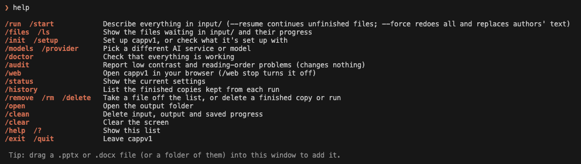

<div align="center">

# cappv1

**Accessible PowerPoint and Word files, with less effort.**

cappv1 writes alt text for the pictures, charts and tables in your `.pptx` and `.docx` files, so people who use a screen reader aren't left with silence. Nothing you can see changes, and your originals are never touched.

[](https://github.com/srsuiux/cappv1/actions/workflows/ci.yml)
[](LICENSE)


</div>

## What it does

A screen reader reads a chart as just "Chart." cappv1 asks an AI model to describe each picture, chart, table, diagram and embedded object, using the slide's title and notes as context, and writes the answer into that item's alt text. This is the same field PowerPoint's and Word's own **Edit Alt Text** panel edits.

| Without alt text, a screen reader says | With cappv1 |
|---|---|
| "Chart." | "Bar chart of enrolment by year, rising from 410 in 2021 to 640 in 2025." |

- **Safe by design.** Layout, text, fonts, colors and pictures stay exactly as they were. It works on a copy and saves a finished file. The only extras it does are listed in [`skills.md`](skills.md), such as marking a table's top row as its header.
- **Builds on what's there.** Alt text a person already wrote is kept or improved, never silently replaced.
- **Picks up where it stopped.** Progress is saved. A crash, a closed laptop or `Ctrl+C` doesn't cost finished work, and nothing is paid for twice.
- **Private if you want it.** Run a vision model on your own computer with Ollama and nothing leaves it. No accounts, no analytics, no tracking.
- **Terminal or browser.** The same engine runs from a terminal session or a small local web page, and they share one run.
- **Word too.** Pictures, tables and embedded objects in `.docx` files, with repairs for [Blackboard Ally](https://www.anthology.com/products/teaching-and-learning/learning-effectiveness/blackboard-ally) scoring.

**Example:** an instructor preparing lecture slides for a blind or low-vision student can make sure every chart, photo and diagram has a description before sharing the deck.

## See it

### In the terminal

Type `cappv1` and a session opens. Drag files in, type `/run`, and watch it work. Type `/` to see every command.


### In the browser

Type `/web` (or run `cappv1 --web`) to open the same tool as a local web page, on this computer only.


| | |
|---|---|
| **Files.** Add files, tick the ones to run, watch progress, and download or delete finished copies kept per run.<br> | **Services.** Choose the AI service and model, and see exactly what each one does with your slides before you pick.<br> |
| **Health.** One page that checks your settings, key and folders, and says how to fix anything that fails.<br> | **Your data.** Everything cappv1 keeps, where it is, and one button to erase it.<br> |

The web pages also have How it works, Privacy, FAQ, Changelog, Appearance (theme and accent color) and About. The API behind them is in [`docs/API.md`](docs/API.md).

## Quick start

```
git clone https://github.com/srsuiux/cappv1.git
cd cappv1
cp .env.example .env        # then set PROVIDER and your key
mkdir -p ~/.local/bin && ln -sf "$(pwd)/bin/cappv1" ~/.local/bin/cappv1
cappv1                      # then type /doctor, drag in a file, and type /run
```

The full walkthrough is below.

## What you need

| You need | How to check |
|---|---|
| **A Mac or Linux computer** (Windows isn't supported yet) | |
| **Python 3.11 or newer** | Open **Terminal** (`Cmd + Space`, type `Terminal`, press Enter) and type `python3 --version`. If it shows 3.11 or higher, you're set. Otherwise install Python from [python.org/downloads](https://www.python.org/downloads/). |
| **An AI service** (an API key from one, or Ollama to run it all on your own computer) | See the next section. |

### Choosing an AI service

An API key is like a password that lets this tool use an AI service. You only need **one** of these:

| Service | Cost | Where to get a key |
|---|---|---|
| **OpenRouter** | Has free models (the default) | [openrouter.ai](https://openrouter.ai) → account settings → API Keys. Keys start with `sk-or-v1-`. |
| **OpenAI** | Paid, a fraction of a cent per image | [platform.openai.com/api-keys](https://platform.openai.com/api-keys) |
| **Anthropic** | Paid, a fraction of a cent per image | [console.anthropic.com](https://console.anthropic.com) → API Keys |
| **Ollama** (runs on your computer) | Free, no key, works offline | [ollama.com/download](https://ollama.com/download). See [Private mode](#private-mode-run-everything-on-your-own-computer). |

Each key only works with its own service. For example, an OpenAI key can't be used through OpenRouter.

> **Privacy:** free OpenRouter models send your slide content through shared third-party providers that may log or train on it. If your slides contain anything sensitive (student names, grades, ID numbers, unpublished research), use [Private mode](#private-mode-run-everything-on-your-own-computer) (nothing leaves your computer), or a paid OpenAI or Anthropic key.

## Install (one time)

**1. Download the project and open it in Terminal.**

```
git clone https://github.com/srsuiux/cappv1.git
cd cappv1
```

**2. Create your settings file and open it.**

```
cp .env.example .env
open -e .env
```

A text editor opens. Make two edits, with no spaces around the `=`:

- Set `PROVIDER=` to `openrouter`, `openai`, `anthropic`, or `ollama`.
- Paste your key after the matching line, for example `OPENAI_API_KEY=sk-...`. (Ollama needs no key. Follow [Private mode](#private-mode-run-everything-on-your-own-computer) instead.)

Leave everything else as it is, then save (`Cmd + S`) and close the window.

**3. Turn on the `cappv1` command.**

```
mkdir -p ~/.local/bin
ln -sf "$(pwd)/bin/cappv1" ~/.local/bin/cappv1
```

**4. Open it and check that it works.**

```
cappv1
```

The first time, it offers to walk you through choosing an AI service. Then type `/doctor` and press Enter. You should see a list of green checkmarks. A red ✗ means something needs fixing, and the line next to it says what.

`cappv1` is the only command you type in Terminal. Everything else (`/run`, `/doctor`, `/models`, ...) is typed inside it.

The first time you open cappv1, it pauses for a few extra seconds to install what it needs. That's normal and only happens once.

## Using it

1. **Open cappv1.** In Terminal, type:
   ```
   cappv1
   ```
   A session opens with a `❯` prompt, like a chat. The first time, it offers to walk you through choosing an AI service.
2. **Add your files.** Drag your `.pptx` or `.docx` files (or a whole folder of them) into the Terminal window, and press Enter. They are copied into the `input` folder for you. You can also copy them there yourself.
3. **Run it.** Type `/run` and press Enter. A live display shows which file and slide it's on and what it's doing right now (looking at a picture, reading a chart, saving the deck). Press `Ctrl+C` to stop; finished slides are remembered.
4. **Collect your files.** Each run saves its finished files, under their original names, in its own folder inside `output`, named for the time it ran (for example `output/2026-10-29_21-28-38/`), so an earlier run is never overwritten. Type `/open` to open `output`, or `/history` to list the runs.
5. **Check the result.** Open a file from `output` in PowerPoint, right-click a picture, table, or chart, and choose **Edit Alt Text**. The descriptions are usually good, but give them a quick read before sharing anything important.

If one file fails, the others still run, and the failed file names are listed at the end. If the run is interrupted (laptop closes, network drops), open cappv1 and type `/run` again. It skips finished files and picks up where it left off.

Type `/` at any time to see the available commands. Animations can be turned off by setting `CAPPV1_NO_ANIMATION=1` (they are also off when `NO_COLOR` is set).

## Commands

Inside the session (type `/` to see them as you type):



| Type this | What it does |
|---|---|
| `/run` | Processes every `.pptx` and `.docx` in `input`, one by one. Add `--resume` to only continue unfinished files, or `--force` to redo everything and replace alt text that authors wrote themselves (it asks first). |
| `/files` | Shows the files waiting in `input` and how far along each is. |
| `/init` | Sets up cappv1 (service, key, model). If it's already set up, it shows what you're using and lets you keep it, change just the model, or switch service. Safe to run again. |
| `/models` | Goes straight to picking an AI service and model. For OpenRouter you can choose free models, the cheapest paid ones, or browse by maker (OpenAI, Google, DeepSeek and more) with prices shown. Each service remembers the model you used last. |
| `/web` | Opens cappv1 in your browser, on this computer only. `/web stop` turns it off. It is a small local site: a front page with an overview, and Files, Services, Health and Your data pages, and pages on how it works, privacy, FAQ and about. The API behind it is in `docs/API.md`. |
| `/audit` | Reports text that is hard to read against its background and slides whose reading order doesn't follow the layout. Reports only; it never changes your file. |
| `/doctor` | Checks your setup. Safe to run any time; it changes nothing. |
| `/status` | Shows the service, model, and whether your slides stay on your computer. |
| `/history` | Lists the finished copies kept from each run. |
| `/remove` | Takes a file off the list (`/remove deck.pptx`), or deletes a finished copy or a whole run (`/remove 2026-10-29_21-28-38`). Asks first. |
| `/open` | Opens the `output` folder. |
| `/clean` | **Permanently deletes** everything in `input` and `output`, plus saved progress. It asks first, but there's no undo. |
| `/clear`, `/help`, `/exit` | Clear the screen, list commands, leave (or press `Ctrl+D`). |

In your normal Terminal prompt there is just one command:

| Type this | What it does |
|---|---|
| `cappv1` | Opens cappv1. Everything above is typed inside it. |
| `cappv1 --batch` | For scripts only: no prompt, processes `input` in the background and shows the log. Add `--resume` or `--force` as in `/run`. |
| `cappv1 --version`, `cappv1 --help` | Show the version, or a short reminder of the above. |

Anything else, like `cappv1 doctor`, is refused with a reminder to open cappv1 first.

## Private mode: run everything on your own computer

With Ollama, the AI model runs on your computer. Your slides, images, and text are never sent to OpenRouter, OpenAI, Anthropic, or anyone else, and after the one-time model download it works with no internet at all. Use this for anything sensitive (student names, grades, ID numbers, unpublished research).

**1. Install Ollama.** Download it from [ollama.com/download](https://ollama.com/download) and open it once. It then runs quietly in the background (look for the llama icon in your menu bar).

**2. Download a model (one time, needs internet).** In Terminal:

```
ollama pull gemma3:4b
```

This is about 3 GB and works on most laptops with 8 GB of memory. The model must be able to read images ("vision"). Other good choices are `qwen2.5vl:7b` and `llama3.2-vision`, which write better descriptions but need more memory and run slower.

**3. Point cappv1 at it.** Open `.env` and set:

```
PROVIDER=ollama
```

If you downloaded a different model in step 2, also set `MODEL=` to its name, for example `MODEL=qwen2.5vl:7b`. Leave all the key lines blank.

**4. Check and run.**

```
cappv1
```

Then type `/doctor`. It should show green checks for "Ollama address is this computer", "Ollama is running", and "model is downloaded". Type `/run` to start. `/models` lists the vision models you have installed and lets you pick one.

**What to expect.** Local models are slower than the online services: roughly several seconds to a minute per image, depending on your computer. They process one image at a time. Small models also write plainer descriptions and are weaker on embedded Word/Excel objects, so read the results before sharing. If quality matters more than privacy, use a bigger local model or an online service.

**Safety check.** cappv1 only talks to Ollama on your own computer (`localhost`). If `OLLAMA_BASE_URL` in `.env` points to any other machine, it refuses to run, so you can't accidentally send slides elsewhere. If you really do run Ollama on another machine you control, set `OLLAMA_ALLOW_REMOTE=1` to allow it.

## Switching AI service or model

Open `.env` and change `PROVIDER=` to another service (make sure that service's key is filled in). Leave `MODEL=` blank to use the service's default, or set a model from that same service:

| Service | Default model |
|---|---|
| OpenRouter | `minimax/minimax-m3:free` (falls back to `google/gemma-3-12b-it`) |
| OpenAI | `gpt-4o-mini` |
| Anthropic | `claude-haiku-5-5` |
| Ollama | `gemma3:4b` (must be downloaded first with `ollama pull`) |

## If something goes wrong

| What you see | What to do |
|---|---|
| `command not found: cappv1` | Run step 3 of Install again from the project folder. If it still fails, run `echo 'export PATH="$HOME/.local/bin:$PATH"' >> ~/.zshrc && source ~/.zshrc`, then try again. |
| A red ✗ in `/doctor` | Read the message beside it. It says what to fix. |
| `API key is not set` or `rejected this key (401)` | Re-check the key in `.env`: no spaces or quotes, and it's on the line that matches your `PROVIDER`. |
| Some images, tables, or charts have no description | The AI service had a temporary hiccup. Type `/run` again; it retries only what's missing. |
| `Ollama is running` shows a red ✗ | Open the Ollama app (or run `ollama serve` in Terminal), then type `/doctor` again. |
| `model ... is downloaded` shows a red ✗ | Run the `ollama pull ...` command shown next to it. |
| Private mode is very slow, or a request times out | Use a smaller model (`gemma3:4b`), close other heavy apps, or raise `REQUEST_TIMEOUT=` in `.env`. |
| A message mentioning "billing" or "402" | That model needs payment. On OpenRouter type `/models` and pick a free one. On OpenAI or Anthropic, add credit to your account. |
| A file doesn't process at all | The file may be damaged. Re-save it from PowerPoint and add it to `input` again. |

## How it works

For each file, the tool goes through the slides one at a time. For each picture, table, chart, or embedded object (a pasted-in Word, Excel, or Visio file, or a SmartArt diagram) it sends the content to the AI along with the slide's title and notes, so the description fits its context. Pictures are sent as images; everything else is sent as text. The AI's answer is written into that shape's alt-text field, the same one PowerPoint's **Edit Alt Text** uses.

**Word documents (`.docx`)** are handled the same way for pictures and tables: the description goes into the picture's or table's alt-text field (the one Word's **Edit Alt Text** pane uses), and the AI sees the nearest heading and the paragraphs around the item as context. Tiny pictures are marked decorative. Embedded objects (such as a Visio drawing) get a description too. Charts, SmartArt, and headers, footers or footnotes are not handled in Word yet, and the accessibility check (`/audit`) reads decks only.

Shapes that are completely invisible (no fill, no outline, no text) are marked as decorative, like PowerPoint's own "Mark as decorative" button, so screen readers skip them. Everything else in the file stays exactly as it was.

## Alt text that's already there, and picking up where it stopped

**If you already wrote alt text, cappv1 builds on it; it never silently replaces it.** For each picture, table, chart, or diagram that already has alt text:

- If it's very short (under 30 characters by default, such as just "Logo"), it's treated as unfinished. The AI writes an improved version that keeps your wording and adds what's missing.
- Otherwise the AI judges it. If it already says what the item shows and why it matters, it's left exactly as you wrote it. If not, an improved version that keeps your wording is used.

The run summary counts these separately ("improved", "kept as written"), so you can see what changed. Change the 30-character cutoff with `MIN_EXISTING_ALT_CHARS` in `.env`. To replace everything with fresh descriptions anyway, use `/run --force`.

**Crashes and interruptions don't cost you finished work.** Each finished file is saved to `output` on its own, and progress is saved as it goes. If cappv1 stops partway through a batch (laptop closes, a crash, `Ctrl+C`), run `/run` again: finished files are skipped, and the file it stopped on continues with its saved descriptions, so nothing is paid for twice. A file that you edit and drop in again is recognised as changed; only the new or edited items are sent to the AI. A file that hasn't changed is reported as already captioned.

## For developers

cappv1 is built in layers that only depend downward:

- `src/pipeline.py`, `pptx_reader.py`, `docx_reader.py`, `llm_client.py` and friends are the **engine**. They know nothing about screens. [`skills.md`](skills.md) documents the one rule any change must follow: this tool writes alt text, plus only the few fixes it lists.
- `src/services/` is the **service layer**: settings, models, files, health checks and runs, as plain functions that return data and raise `ServiceError` with a plain-language message.
- `src/tui/` (the terminal session) and `src/web/` (the local web server and pages) are the two **front ends**. They only ask and draw.

Settings live in `.env`; see `.env.example` for the full list. Set `CAPPV1_HOME` to keep `.env`, `input/`, `output/` and saved progress in another folder instead of the project folder.

Run the tests with `pip install -r requirements-dev.txt` and then `python -m pytest`. They use a temporary workspace and a fake local model, never your real settings or keys.

| Read | For |
|---|---|
| [`docs/ARCHITECTURE.md`](docs/ARCHITECTURE.md) | How the code is laid out |
| [`docs/API.md`](docs/API.md) | The local web API |
| [`skills.md`](skills.md) | The one product rule |
| [`CONTRIBUTING.md`](CONTRIBUTING.md) | How to contribute and release |
| [`SECURITY.md`](SECURITY.md) | Reporting a security problem |
| [`CHANGELOG.md`](CHANGELOG.md) | What changed in each version |

## License and contributing

cappv1 is free and open source under the [MIT License](LICENSE): use it, change it, and share it. Contributions are welcome; see [CONTRIBUTING.md](CONTRIBUTING.md). Release notes are in [CHANGELOG.md](CHANGELOG.md).
