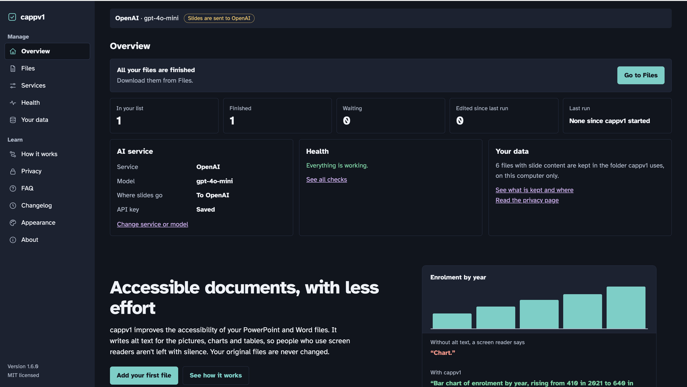
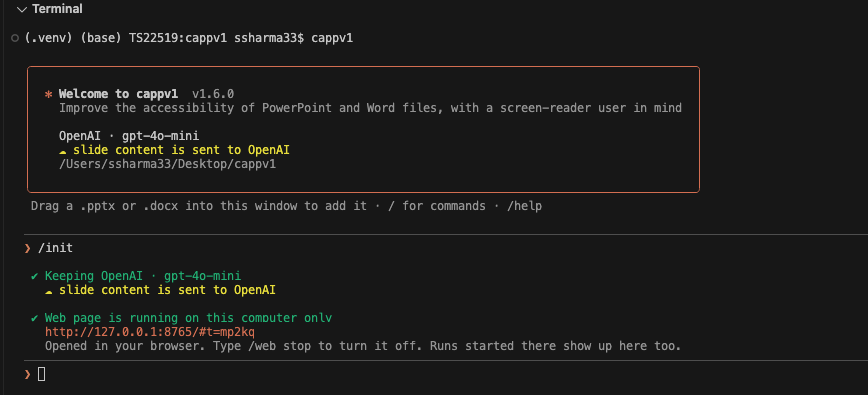
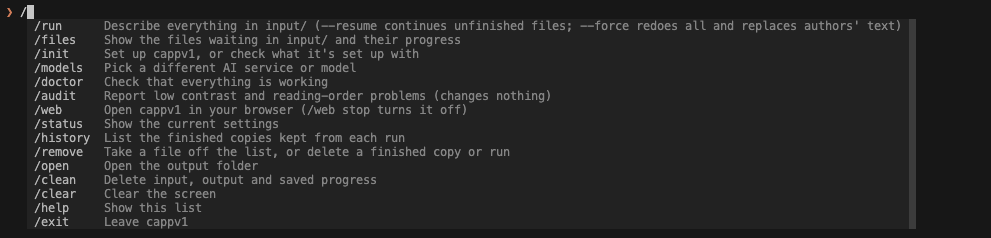
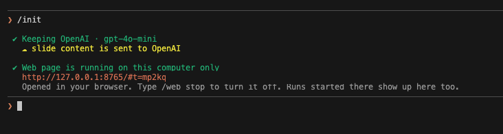
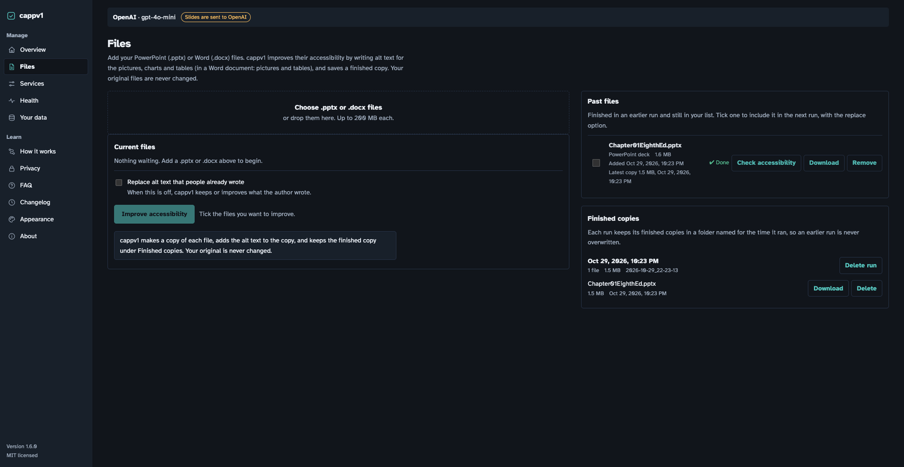
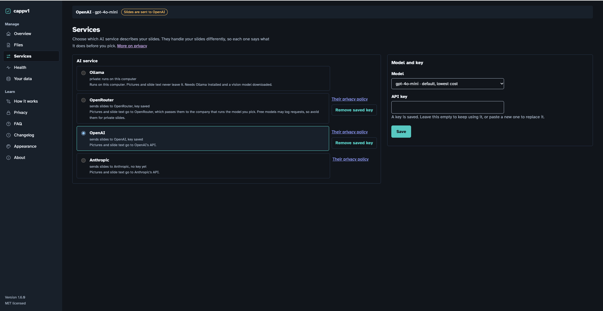
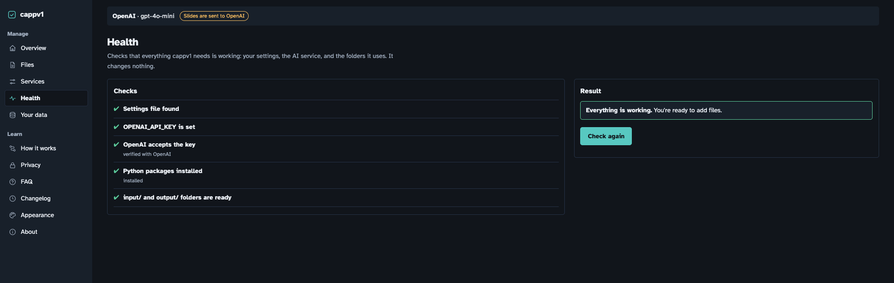
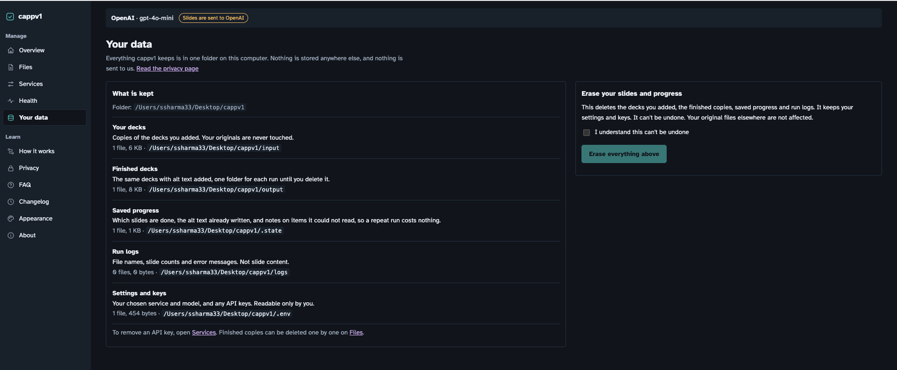

<div align="center">

# cappv1

**Accessible PowerPoint and Word files, with less effort.**

cappv1 writes alt text for the pictures, charts and tables in your `.pptx` and `.docx` files, so people who use a screen reader aren't left with silence. Nothing you can see changes, and your originals are never touched.

[](https://github.com/srsuiux/cappv1/actions/workflows/ci.yml)
[](https://codecov.io/gh/srsuiux/cappv1)
[](LICENSE)




</div>

## What it does

A screen reader reads a chart as just "Chart." cappv1 asks an AI model to describe each picture, chart, table, diagram and embedded object, using the slide's title and notes as context, and writes the answer into that item's alt text. This is the same field PowerPoint's and Word's own **Edit Alt Text** panel edits.

| Without alt text, a screen reader says | With cappv1 |
|---|---|
| "Chart." | "Bar chart of enrolment by year, rising from 410 in 2021 to 640 in 2025." |

- **Safe by design.** Layout, text, fonts, colors and pictures stay exactly as they were. It works on a copy and saves a finished file. The only extras it does are listed in [`docs/scope.md`](docs/scope.md), such as marking a table's top row as its header.
- **Builds on what's there.** Alt text a person already wrote is kept or improved, never silently replaced.
- **Picks up where it stopped.** Progress is saved. A crash, a closed laptop or `Ctrl+C` doesn't cost finished work, and nothing is paid for twice.
- **Private if you want it.** Run a vision model on your own computer with Ollama and nothing leaves it. No accounts, no analytics, no tracking.
- **Terminal or browser.** The same engine runs from a terminal session or a small local web page, and they share one run.
- **Word too.** Pictures, tables and embedded objects in `.docx` files, with repairs for [Blackboard Ally](https://www.anthology.com/products/teaching-and-learning/learning-effectiveness/blackboard-ally) scoring.

**Example:** an instructor preparing lecture slides for a blind or low-vision student can make sure every chart, photo and diagram has a description before sharing the deck.

## See it

### In the terminal

Type `cappv1` and a session opens. Drag files in, type `/run`, and watch it work. Type `/` to see every command.





### In the browser

Type `/web` (or run `cappv1 --web`) to open the same tool as a local web page, on this computer only.



| | |
|---|---|
| **Files.** Add files, tick the ones to run, watch progress, and download or delete finished copies kept per run.<br> | **Services.** Choose the AI service and model, and see exactly what each one does with your slides before you pick.<br> |
| **Health.** One page that checks your settings, key and folders, and says how to fix anything that fails.<br> | **Your data.** Everything cappv1 keeps, where it is, and one button to erase it.<br> |

The web pages also have How it works, Privacy, FAQ, Changelog, Appearance (theme and accent color) and About. The API behind them is in [`docs/API.md`](docs/API.md).

## Quick start

```
pipx install git+https://github.com/srsuiux/cappv1.git
cappv1                      # then type /init, drag in a file, and type /run
```

You need a Mac or Linux computer, Python 3.11 or newer, and an AI service (an API key, or Ollama to run it all on your own computer). The full walkthrough is in [docs/install.md](docs/install.md).

## Commands

Type `cappv1` in Terminal to open a session, then type `/` to see every command. The main ones:

| Type this | What it does |
|---|---|
| `/run` | Processes every `.pptx` and `.docx` in `input`, one by one. |
| `/files` | Shows the files waiting in `input` and how far along each is. |
| `/init`, `/models` | Choose the AI service and model. |
| `/web` | Opens cappv1 in your browser, on this computer only. |
| `/doctor` | Checks your setup. Changes nothing. |
| `/history`, `/open` | List the finished copies from each run, or open the `output` folder. |

`cappv1 --batch` runs without a prompt, for scripts. The full table is in [docs/usage.md](docs/usage.md).

## Docs

- [Install](docs/install.md), [Using cappv1](docs/usage.md) and [Troubleshooting](docs/troubleshooting.md)
- [AI services](docs/providers.md), including private mode with Ollama, and [Configuration](docs/configuration.md)
- [Privacy](docs/privacy.md) and [Word documents](docs/word-support.md)
- [Development](docs/development.md), [Architecture](docs/ARCHITECTURE.md) and the [local web API](docs/API.md)

Everything is indexed in [docs/README.md](docs/README.md).

## License and contributing

cappv1 is free and open source under the [MIT License](LICENSE): use it, change it, and share it. Contributions are welcome; see [CONTRIBUTING.md](CONTRIBUTING.md). Release notes are in [CHANGELOG.md](CHANGELOG.md).
